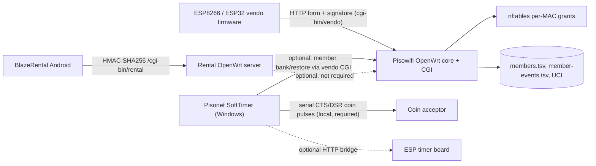
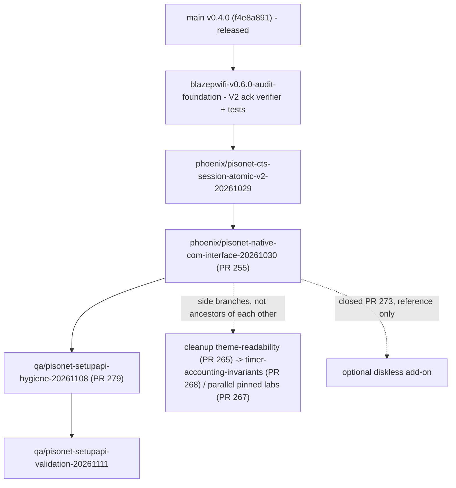
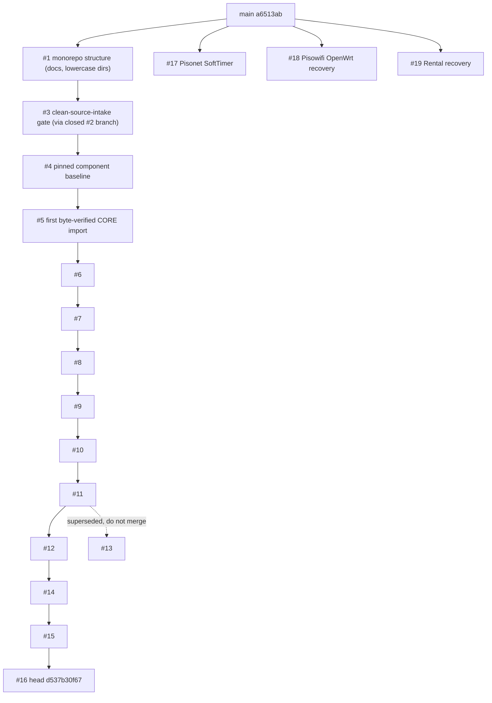

# Dependency Map

Scope: relationships verified from repository contents and PR metadata on 2026-11-11. "Stack" means a chain of draft PRs where each PR's base is the previous PR's head branch.

## 1. Runtime dependencies between products

Hard rules taken from the repositories' own documents and kept here: SoftTimer works with **no** PisoWiFi/Rental/diskless component; Rental and PisoWiFi are independently deployable; diskless manager is a separate add-on.

## 2. Source-lineage dependencies (what must land before what)

### SoftTimer (linear, verified with `git merge-base --is-ancestor` in `BlazingSystems-Experiments`)

`CoinOperatedEcosystem` PR #17 is a *separate, already-curated* import of this chain (pinned to Experiments `21b065535640…`) with additional fail-closed fixes. It is the destination of record; do not re-import.

### PR stack in `CoinOperatedEcosystem`

PRs #17, #18, #19 target `main` directly and are independent of the #1–#16 stack. The #1–#16 branches were cut from the initial commit (`b0b0ebc`) and do **not** contain `main`'s `a6513ab` (verified: `main` is not an ancestor of #16's head); #1 → branding anchor (closed #2) → #3 ancestry was verified with `git merge-base --is-ancestor`.

## 3. Overlap / duplication found

| Concern | Locations | Evidence |
|---|---|---|
| OpenWrt core files duplicated and **diverged** | `core/openwrt/rootfs/{etc/init.d/blazepwifi,usr/lib/blazepwifi/capabilities.sh,usr/lib/blazepwifi/config.sh,usr/sbin/blazepwifi-core}` (#5–#16) vs `Pisowifi/openwrt/rootfs/…` (#18) | same relative file names; `capabilities.sh` blobs differ (`16ea0a9e…` vs `098eafbe…`) |
| Case-colliding directory names | `Pisonet/` (`main`, #17) vs `pisonet/` (#1); `Rental/` (#19) vs `rental/` (#1) | `git ls-tree` of #1 and `main`; breaks checkout on case-insensitive filesystems (Windows/macOS) |
| SoftTimer baseline attempted twice | #17 (kept) vs my closed #20 (v0.4.0 import) | #20 closed as superseded, branch kept as reference only |

## 4. Shared services (genuine integration needs only)

| Contract | Producer | Consumers | Present as code? |
|---|---|---|---|
| Controller signature / nonce / replay | PisoWiFi vendo CGI | ESP firmware, SoftTimer | implemented in each; **no shared schema** |
| Member bank/restore/transfer + event id | PisoWiFi | SoftTimer | implemented; **no shared schema** |
| Rental enrollment + lease status | Rental server | Android | implemented in #19; versioned `docs/API_v1.md` |
| Ledger events, idempotency keys, policy revision | none | none | **not defined** |

No shared contracts directory has content. Introduce contracts only when two products must interoperate (member bank/restore and controller signature are the first two candidates).
